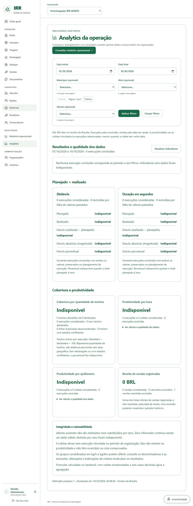
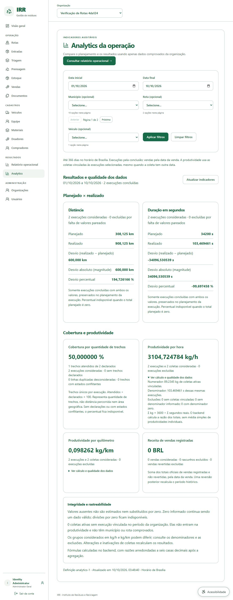
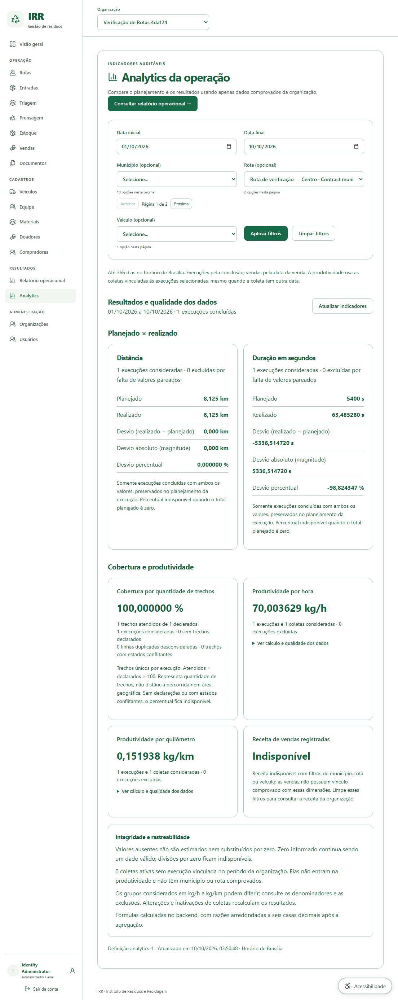

# Native MVP Analytics integration

Maintainer: [Enzo Ribas (@oEnzoRibas)](https://github.com/oEnzoRibas). Date: 2026-10-10.

Implements frontend ADR-0021 and backend ADR-0022. Backend source `996e36f` publishes GET /api/v1/reports/analytics; the actual running OpenAPI is pinned with 116 supported v1 operations. The existing operations-1 report remains separate. No runtime dependency, migration or rewritten frontend is required.

## Operator workflow

Select an organization, then open Results → Analytics. Apply inclusive Brazilian dates and optional historical municipality/route/vehicle filters. The displayed interval identifies the applied result; editing a filter alone does not silently change it. Refresh to obtain live corrections. Clear filters to restore the current Brazilian month through today.

Planned/actual distance and duration show matched sums, signed deviation, absolute magnitude and percentage. Coverage counts unique execution/source-section pairs, with declared/covered counts and duplicate/conflict warnings. It does not represent distance or geographic area. Productivity cards show weighted kg/h and kg/km from linked active receipts and their own eligible execution cohorts. Expand the calculation details to inspect exact numerator/denominator and missing/zero/receipt exclusions. Receipt dates can differ from execution-completion dates.

Revenue sums active POSTED sales at their sale dates; later reversal removes historical contributions on reread. Revenue is unavailable under municipality/route/vehicle filters because the model has no commercial execution provenance. Missing or zero denominators produce unavailable ratios, while a measured zero remains an explicit source value. The frontend formats server decimal strings and never calculates business indicators.

## Development and verification

Use the existing local stack and ignored credential reference. Set public VITE_API_BASE_URL=http://localhost:9292/api/v1 for the current identity worktree, with private IRR_BACKEND_ENV pointing at its ignored contract.env. No secret belongs in a VITE_* value. Rebuild the frontend image after source or public build configuration changes.

Run `npm run lint`, `npm run typecheck`, `npm test`, `npm run build`, `npm run api:check` and the documented local `npm run test:contract`. Types come from the current generated Swagger, not handwritten guesses. Tests cover server-result precision, explicit unavailable values, definitions/counts, filter submission, safe failure/retry and refreshed revenue. Real contract fixtures verify two linked receipts with one denominator, preserved plan snapshots, scoped filters and post/reverse revenue.

## Evidence and remaining limits

The corrected full frontend run passed all 127 tests in 16 files. Lint and all TypeScript gates passed again. The six new Analytics component tests passed; the 26 real-backend tests also passed. The initial ambiguous loading-selector failure is resolved.

Backend full source-only Maven verification: 51 unit/95 real PostgreSQL/Redis integration tests passed, no failures/errors/skips. Backend image build and startup passed. Frontend lint/types/build and pinned 116-operation check passed. All 26 real API contract tests passed, including byte-for-byte delivery of the valid synthetic PDF. Initial component run had one ambiguous loading-selector assertion; corrected and rerun before acceptance. Final browser/screenshots and component results are recorded below.

### Actual browser evidence

The rebuilt frontend at 9e25e91 and backend at 996e36f were inspected in the authenticated in-app browser at localhost:5173 on 2026-10-10. Existing synthetic organizations were read without changing business records. The empty Homologação IRR 669850 organization showed unavailable comparisons/productivity/coverage, zero valid revenue and one excluded reversed sale. Verificação de Rotas 4da124 showed two completed executions, 50% section-count coverage, 89.2345 kg and 3104.724784 kg/h from 103.469461 actual seconds. These brief synthetic executions are test facts, not representative operational performance.

Applying the Centro route filter reduced the population to one execution, preserved planned/actual 8.125 km, showed 100% section-count coverage, 70.003629 kg/h and 0.151938 kg/km. Revenue changed to unavailable with the explicit missing-provenance explanation. Expanded calculation details exposed exact numerator/denominator and exclusion counts. Reversal recalculation was verified through real API tests and SQL integration tests, rather than inferred from the browser's zero-sales fixtures.

This scope implements the newly approved four families. Additional recovery/reject metrics, published stock/financial closures, global comparisons, targets, alerts, exports and GPS retain their separate definitions/dependencies. Local verification does not establish operator acceptance or deployment readiness.
