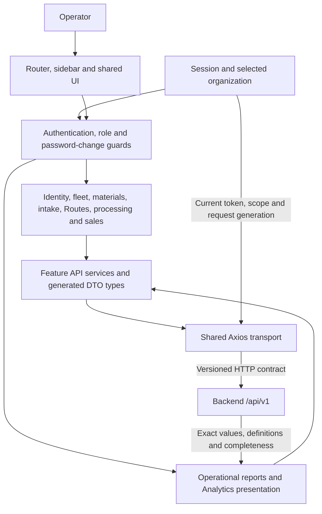
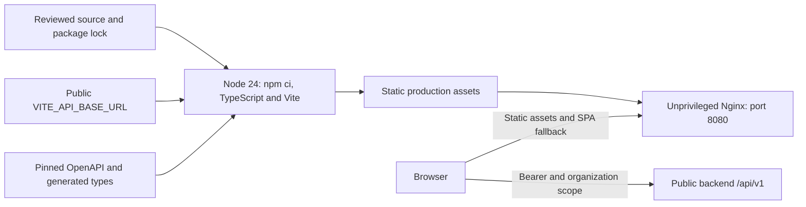

# Frontend architecture

Maintainer: [Enzo Ribas (@oEnzoRibas)](https://github.com/oEnzoRibas). Reviewed 2026-10-10.

React 18, TypeScript 5 and Vite 6 remain the existing stack. React Router organizes protected routes; feature services use one Axios transport and generated OpenAPI types. Formik and Tailwind remain in use. Product content is Brazilian Portuguese; engineering documentation is English. This continues the existing Master Plan and backend `/api/v1` contract.

## Application boundaries

The backend validates authorization and organization ownership on every relevant request. Router guards do not replace it. The transport applies current bearer/scope headers and rejects stale responses after session/organization changes. Analytics formulas live in the backend; the frontend formats values and explains unavailable/incomplete metrics. Theme, contrast, font sizing and dialogs belong to shared UI; complete browser accessibility acceptance remains open.

## Build and runtime separation

Node/Tailwind are build dependencies, not production HTTP servers. Nginx runs as UID 101 with a read-only filesystem and `/tmp` tmpfs in the local Compose setup. Database/Redis credentials, RSA private keys and development login credentials never belong in Vite variables. Changing the API origin requires rebuilding the bundle.

## Railway preparation

The same Dockerfile produces the proposed Railway frontend service. Use public HTTPS backend origin ending `/api/v1`, exact backend CORS, port 8080 and `/health`. The browser cannot use private Railway DNS. Public services, secrets, domains and production deployment have not been provisioned. Backend `docs/architecture/system-diagrams.md` contains the coordinated runtime/module/transaction/Railway diagrams. See [release readiness](release-readiness.md) for separate technical, deployment and client acceptance gates.
