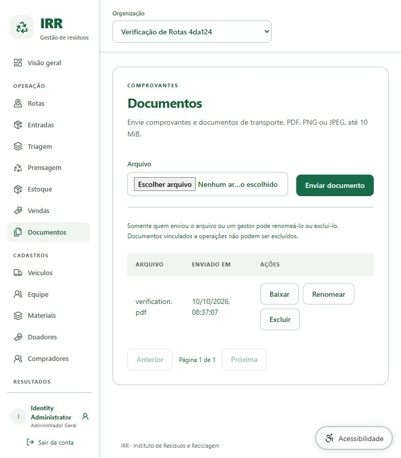
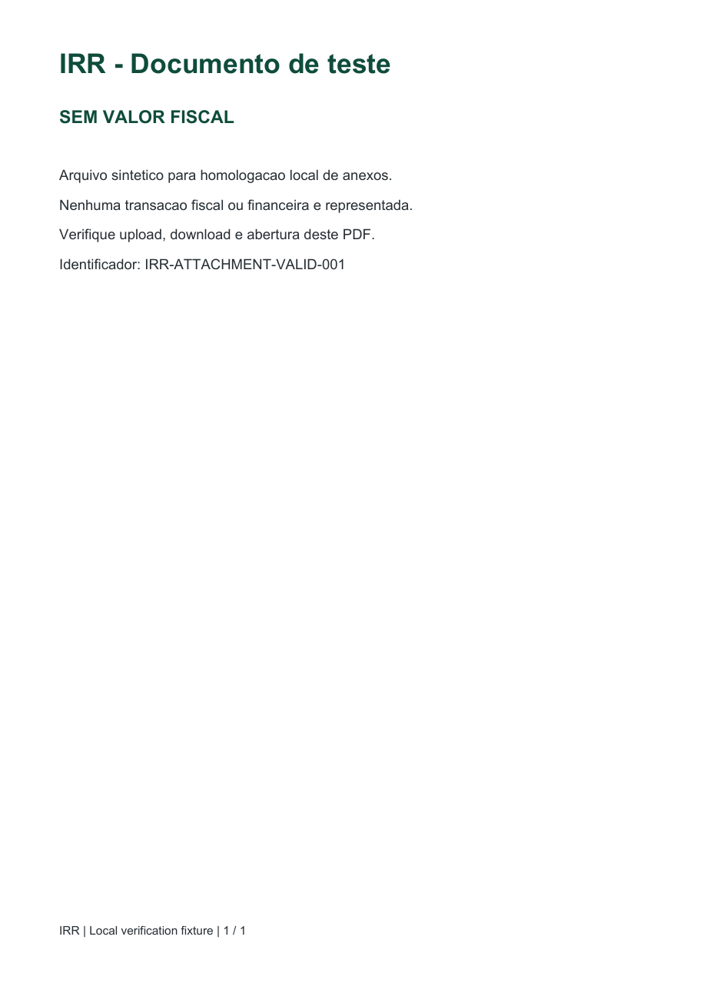

# Local attachment download verification

Maintainer: [Enzo Ribas (@oEnzoRibas)](https://github.com/oEnzoRibas). Verified 2026-10-10. Continues the local Master Plan attachment/recovery gate.

## Actual operator journey

With the existing authenticated development administrator and synthetic organization Verificação de Rotas 4da124, open Documents, choose the repository's tests/fixtures/verification.pdf and submit Enviar documento. The new row appeared with its filename and actions. Clicking Baixar produced the actual browser download. After the backend backup stop/restart, reloading the page and selecting the organization showed the retained document again.

The fixture is explicitly marked SEM VALOR FISCAL and represents no financial transaction. It is retained as a standalone document for local inspection, without modifying any earlier sale/invoice or stock history. The original malformed historical fixture remains historical evidence; it was not silently replaced.

## Byte and render checks

The repository fixture and actual browser download have identical SHA-256: 1716a8a315fe809bb0e4595dfcf0fd6c59358bcd75fbec3a455ac5145b058410. A strict pypdf read found one page and IRR-ATTACHMENT-VALID-001. Poppler rendered the actual downloaded bytes; visual inspection confirmed readable, unclipped text. Poppler emitted a missing Symbol display-font warning, but the document contains no affected symbol and the visible page rendered correctly.

The image below is a PDF render, not a screenshot of an opened browser viewer:

The in-app browser policy rejects file:// navigation. The attempt to open the downloaded file in that browser was blocked; no bypass was attempted and viewer acceptance is not claimed. The owner can open the downloaded verification.pdf with their normal PDF viewer. Browser delivery, byte equality and PDF validity/rendering are verified independently of that remaining manual check.

## Recovery coverage

This valid document was included in the subsequent V1-V4 backup. The isolated PostgreSQL restore matched 39 public-table row counts, 20 attachment references and all 20 individual file hashes; inventory movements, available lots and balances had zero differences. The running backend returned healthy and the document remained accessible. The backend docs/recovery-verification.md records selection arguments, private evidence and limitations.

No frontend production code or dependency changed in this slice. Previous Analytics lint/types/build/127-test and 26-real-API results remain dated evidence; this slice adds an actual browser attachment journey and verified backup coverage rather than claiming a fresh full application suite.
